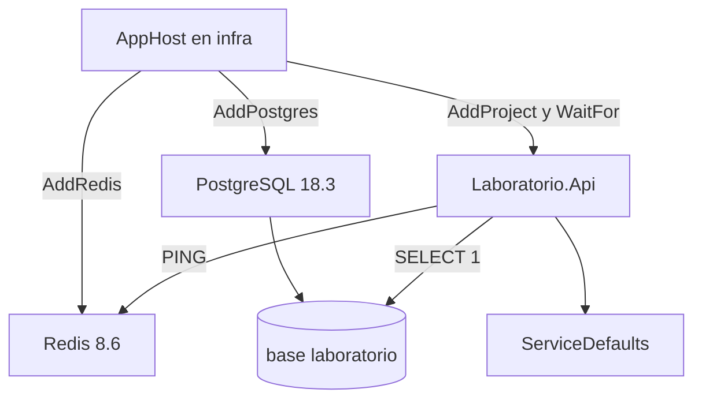

# Laboratorio de contenedores — Parte 2

Autor: Genesis Bailon Anchundia. Asignatura: Integración de Sistemas y Plataformas. Repositorio: [Genesis12-hub/laboratorio-contenedores-parte2](https://github.com/Genesis12-hub/laboratorio-contenedores-parte2).

## Objetivo

Integrar una API .NET 10 con Redis y PostgreSQL mediante Aspire. El `AppHost` crea esos recursos, espera a que acepten conexiones y la API comprueba `PING` y `SELECT 1` sin guardar contraseñas en el repositorio.

## Relación con el laboratorio 1

El [laboratorio 1](https://github.com/Genesis12-hub/laboratorio-contenedores-parte1) comprueba Docker y un Redis arrancado a mano (`redis:7-alpine`, `PING`/`PONG` en `127.0.0.1:6379`). Este laboratorio es otro repositorio. Aspire 13.6.4 provisiona sus propios contenedores (`redis:8.6` y `postgres:18.3`) y les asigna puertos de host distintos. No hace falta dejar encendido `parte1-redis` ni ocupar el puerto 6379.

## Arquitectura



| Proyecto | Ruta | Referencias |
| --- | --- | --- |
| `AppHost` | `infra/AppHost` | [`Laboratorio.Api`](src/Laboratorio.Api/Laboratorio.Api.csproj). Paquetes `Aspire.Hosting.Redis` y `Aspire.Hosting.PostgreSQL` 13.6.4. |
| `Laboratorio.Api` | `src/Laboratorio.Api` | [`ServiceDefaults`](src/ServiceDefaults/ServiceDefaults.csproj). Paquetes `Aspire.StackExchange.Redis` y `Aspire.Npgsql` 13.6.4. |
| `ServiceDefaults` | `src/ServiceDefaults` | Plantilla oficial: `/health`, `/alive` y OpenTelemetry. |

[`Laboratorio.slnx`](Laboratorio.slnx) agrupa `infra` y `src`. [`global.json`](global.json) fija el SDK 10.0.114 con `latestPatch`. Las versiones de NuGet están en cada `.csproj` y en `packages.lock.json`. [`nuget.config`](nuget.config) solo usa nuget.org.

La API expone `GET /`, `GET /health` (Redis y PostgreSQL), `GET /alive` y `GET /status` (`PING` y `SELECT 1`, sin contraseñas ni cadenas de conexión).

## Matriz de requisitos

| Requisito | Cumplimiento | Evidencia |
| --- | --- | --- |
| Repositorio distinto del laboratorio 1 | Este repositorio no contiene el laboratorio 1 | Enlace de la sección anterior |
| AppHost .NET 10 dentro de `infra` | `net10.0` y `Aspire.AppHost.Sdk` 13.6.4 | [`infra/AppHost/AppHost.csproj`](infra/AppHost/AppHost.csproj) |
| `Laboratorio.Api` y `ServiceDefaults` | Proyectos en `src` | [`Program.cs`](src/Laboratorio.Api/Program.cs), [`Extensions.cs`](src/ServiceDefaults/Extensions.cs) |
| Referencias entre proyectos | `ProjectReference` y `WithReference` | csproj citados y [`AppHost.cs`](infra/AppHost/AppHost.cs) |
| Redis y PostgreSQL | `AddRedis`, `AddPostgres` y base `laboratorio` | [`AppHost.cs`](infra/AppHost/AppHost.cs) |
| Panel con la API, Redis y PostgreSQL en ejecución | Cuatro recursos en Running | [`04_panel_recursos.png`](docs/capturas/04_panel_recursos.png). La captura anterior sigue en [`01_aspire_dashboard.png`](docs/capturas/01_aspire_dashboard.png) |
| Salud y conectividad real | HTTP 200, `PONG` y `SELECT 1` | [`02_terminal_pruebas.png`](docs/capturas/02_terminal_pruebas.png), [`03_navegador_status.png`](docs/capturas/03_navegador_status.png), [`validacion-2026-11-07-bogota.txt`](docs/validacion-2026-11-07-bogota.txt) |

## Requisitos y ejecución

- .NET SDK 10.0.114, o un parche posterior de la banda 10.0.1xx.
- Docker Engine en marcha y el socket unix accesible. Aspire descarga `redis:8.6` y `postgres:18.3`.
- El panel queda en localhost y pide el token que imprime la consola. No hace falta desactivar esa autenticación.

Aspire guarda las contraseñas de Redis y PostgreSQL en user-secrets del AppHost (`UserSecretsId` del `.csproj`), fuera de este repositorio. No las copies al código ni a `appsettings.json`.

```bash
dotnet restore Laboratorio.slnx
dotnet build Laboratorio.slnx
dotnet run --project infra/AppHost/AppHost.csproj --launch-profile https
```

El perfil `https` abre el panel en `https://localhost:17023`. Los puertos de la API en [`launchSettings.json`](src/Laboratorio.Api/Properties/launchSettings.json) son `http://localhost:5034` y `https://localhost:7092`. Si el panel muestra otros, usa esos.

```bash
curl -fsS http://localhost:5034/health
curl -fsS http://localhost:5034/alive
curl -fsS http://localhost:5034/status
```

## Entorno real y limitaciones

Las dos comprobaciones se hicieron en Linux Ubuntu 24.04.5 x64 (máquina remota, kernel 6.12.113+). No se ejecutaron en el equipo Windows del estudiante ni en WSL. `systemd` no es el proceso 1 y `policy-rc.d` impide arrancar el servicio, así que Docker se inició con `dockerd` y los puertos publicados quedaron en `127.0.0.1`.

Las horas de esta sección están en America/Bogotá (UTC−5). El reloj del escritorio de la máquina está en UTC y por eso marca el 8 de noviembre cuando en Bogotá sigue siendo el 7.

[`docs/capturas/01_aspire_dashboard.png`](docs/capturas/01_aspire_dashboard.png) es la captura anterior del panel (SHA-256 `9fa11ca723926d20d1b198e6857e3e50f49dd4722d8bf62f3cbb91a956aa54a0`). No se modificó. En esa ejecución el SDK era 10.0.114, el runtime 10.0.14, Aspire 13.6.4 y Docker Engine 29.1.3.

A las 21:53 del 7 de noviembre de 2026 se repitió la prueba con el AppHost en marcha y se fotografió la pantalla. El terminal está en [`docs/capturas/02_terminal_pruebas.png`](docs/capturas/02_terminal_pruebas.png) y el texto copiado en [`docs/validacion-2026-11-07-bogota.txt`](docs/validacion-2026-11-07-bogota.txt): `dotnet build` terminó con 0 advertencias y 0 errores; `/health` y `/alive` respondieron `Healthy` con HTTP 200; `/status` respondió HTTP 200 con `PONG` y `postgres` `ready` (latencia 0.7303 ms en esa llamada). Redis 8.6.8 contestó `PONG` y PostgreSQL 18.3 devolvió `1` en la base `laboratorio`. No hay proyecto de pruebas: no se presenta `dotnet test` como una suite aprobada.

El navegador, en [`docs/capturas/03_navegador_status.png`](docs/capturas/03_navegador_status.png), abrió `http://127.0.0.1:5034/status` y mostró el JSON real de otra llamada (`redisLatencyMs` 0.6836). El panel de esa misma ejecución está en [`docs/capturas/04_panel_recursos.png`](docs/capturas/04_panel_recursos.png): `postgres`, `laboratorio`, `redis` y `laboratorio-api` en Running, con `https://localhost:17023` marcado «Not secure». El comando de Redis aparece cortado (`--requirepass $REDI…`) y no muestra la contraseña. El token del panel no está en las capturas.

[`docs/validacion-2026-11-08.txt`](docs/validacion-2026-11-08.txt) es la transcripción anterior. El nombre del archivo usa la fecha UTC; en Bogotá esa corrida fue el 7 de noviembre, alrededor de las 21:38. SDK 10.0.114, runtime 10.0.14, Aspire 13.6.4, Docker Engine 29.9.3, containerd 2.4.2 y runc 1.5.2. El puerto 6379 del host no estaba en uso.

## Entrega

La entrega de la asignatura es solo la URL de este repositorio. Aquí no se afirma una publicación en Azure. El acceso de lectura para freddy.alarcon@uleam.edu.ec no está configurado y no se envió invitación. El repositorio es público, así que esa URL alcanza para leerlo.
